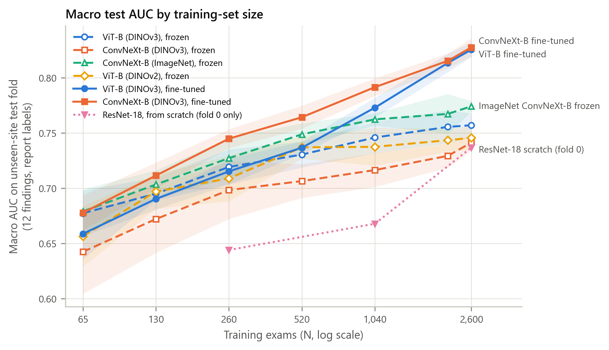

# How Much Data Does a Hospital Need?

**Data efficiency of CNNs vs. pretrained transformers for knee-MRI diagnosis**

Group project for MGMTMSA 432 Healthcare Analytics (UCLA Anderson, Fall 2026), Group 8: Tirth Patel and Giulio Elmi.

A hospital that wants its own knee-MRI triage model has to decide early how many exams to collect and label, and which model to use. This project measures how diagnostic accuracy (macro ROC-AUC over 12 findings) grows as the number of training exams goes from 65 to 2,600. It compares five pretrained and from-scratch backbones, used both frozen and fine-tuned, and turns the resulting learning curves into exam counts and dollar costs.

> This is a course project. It uses the RSNA 2026 Knee Abnormality Detection data, but it is not a Kaggle competition entry.

---

## Key findings

| Question | Result |
|---|---|
| **RQ1: Does accuracy level off by 2,600 exams?** | No. AUC rises roughly linearly in log N: about **+0.020 per doubling** for frozen backbones and **+0.031** for fine-tuned ones. A log-linear curve fits better than the pre-registered power law on 8 of 10 curves. |
| **RQ2: Fine-tuned vs. frozen** | Below ~500 exams the frozen backbone is as good or better. From ~1,000 exams on, fine-tuning wins: +0.068 (ViT-B) and +0.086 (ConvNeXt-B) AUC at N = 2,600. |
| **RQ3: Architecture vs. pretraining** | Fine-tuned, the DINOv3 CNN beats the DINOv3 ViT at N = 260–1,040, and the two tie at 2,080 and above. Frozen, the ViT is better. Frozen, supervised ImageNet ConvNeXt-B beats DINOv3 ConvNeXt-B at every N and on every test site. |
| **RQ4: Which findings need more data?** | Focal tears and fractures trail fluid and soft-tissue findings by about 0.054 AUC, and still by 0.040 when compared at an equal number of positive examples. Rarity explains only part of the gap. |
| **RQ5: What does it cost?** | Fine-tuned DINOv3 ConvNeXt-B reaches AUC 0.75 with **~313 exams** and AUC 0.80 with **~1,333 exams**, using under $2 of compute on a laptop GPU. Expert labelling costs about $45k per 1,000 exams; local LLM labels from the reports cost about $1 per 1,000. |

The model rankings hold on the 58 expert-labelled studies (Spearman ρ = 0.97 vs. the report-labelled test folds) and across the five unseen test sites (Kendall's W = 0.94).



---

## Study design

**Data.** RSNA 2026 Knee Abnormality Detection: 4,407 studies (one per patient), 24,371 series and 819,078 slices from about 20 sites on five continents and five scanner vendors. Each study has 12 binary findings: ACL, MCL, medial and lateral meniscus, medial / lateral / patellofemoral OA, effusion, synovitis, Baker's cyst, bone contusion and fracture.

**Labels.** Only 58 studies carry expert image labels (the "gold" set). For all other studies, a local LLM (`qwen3:14b`) read the free-text radiology reports, which come in nine or more languages. Those report labels score 0.866 macro AUC against the gold set. No images or reports left the workstation.

**Unseen-site evaluation.** Studies are grouped by scanner fingerprint into five folds of about 870 studies each. Each rotation uses one fold as the test site and the next fold for validation. The other three folds (about 2,610 studies) form the training pool. Nested training subsets of N = 65, 130, 260, 520, 1,040, 2,080 and 2,600 are drawn from that pool. Test folds and the gold set are scored once, after model selection on the validation fold.

**Models.** Each study goes through the same attention-pooling head, so the backbone and the training regime are the only things that change.

| ID | Backbone | Pretraining | Regimes |
|---|---|---|---|
| M1 | ViT-B/16 | DINOv3, 1.7B images | frozen, fine-tuned |
| M2 | ConvNeXt-B | DINOv3, 1.7B images | frozen, fine-tuned |
| M3 | ConvNeXt-B | supervised ImageNet-22k → 1k | frozen |
| M4 | ViT-B/14 + registers | DINOv2, 142M images | frozen |
| M5 | ResNet-18 | none | from scratch |

M1 vs. M2 isolates the architecture (same pretraining), and M2 vs. M3 isolates the pretraining (same architecture). The frozen sweep has 1,680 runs (5 rotations × 3 seeds × 4 hyperparameter settings). The fine-tuning sweep has 42 runs (3 rotations, 1 seed). All of it ran on a single RTX 5070 Ti laptop GPU (12 GB). Hypotheses H1–H5 were pre-registered on 2026-10-25, before any results existed.

---

## Repository layout

```
code/            Pipeline, analysis and report-building scripts (see below)
manifests/       Rotation splits (rotations.json) and nested training subsets (subsets_r{r}_s{s}.json)
results/
  runs.parquet   One row per run x split x finding: every metric the analysis uses
  tables/        CSV tables behind every table and number in the report
  fits/          Learning-curve fit parameters
  musd/          Per-rotation feature standardisation statistics for the frozen embeddings
figures/         Report figures F1-F8 (PNG + PDF)
labeling/        v2 report-labelling experiment (tested and rejected; the study trains on the v1 labels)
label_audit/     Manual audits of the v1 LLM labels (cell-level verdicts with short paraphrased evidence; no report text)
report/          Final report workbook (.docx)
PROJECT_PLAN.md  Full study protocol, pre-registered hypotheses and decision log
RESULTS_LOG.md   Dated log of finished tasks and key numbers
```

### Code

| Stage | Scripts |
|---|---|
| Shared paths, metrics, memory guards | `common.py` |
| Splits and subsets | `make_splits.py`, `make_subsets.py` |
| Frozen learning curves | `train_frozen_lc.py`, `sweep_frozen.py` |
| Fine-tuning | `ft_data.py`, `ft_model.py`, `train_ft.py`, `bench_ft.py`, `sweep_ft.py` |
| Analysis | `collect_results.py`, `describe_data.py`, `bootcache.py`, `fit_curves.py`, `stats_tests.py`, `cost_model.py` |
| Figures and report | `viz.py`, `make_figures.py`, `build_workbook.py`, `make_submission.py` |
| Utilities | `memlog.py` (RAM/VRAM logger for long GPU jobs) |

Each script's docstring explains its inputs, outputs and command-line options.

---

## Reproducing the results

### What is not in this repository

- **The data.** The RSNA dataset (~570 GB of DICOM) cannot be redistributed. Get it from the Kaggle competition page and accept its rules.
- **The preprocessing pipeline.** DICOM decoding, orientation canonicalisation, the 84 GB pixel cache, the frozen embeddings and the v1 LLM labels (`targets.parquet`) all come from an earlier pipeline kept in a separate folder (`T:\Kaggle_Knee_Competition\src`). `code/common.py` imports the study head, bag builder and metrics from it.
- **Per-run outputs** (`runs/`, ~16 GB of checkpoints and predictions), the bootstrap cache (`results/cache/`) and any file that quotes report text. All metrics are already aggregated in `results/runs.parquet`.

Paths are hard-coded in `code/common.py` (`T:\Group_Project` and `T:\Kaggle_Knee_Competition`). Edit them there if your layout is different.

### Environment

Python 3.11 with PyTorch (a CUDA build that supports your GPU), timm, scikit-learn, scipy, statsmodels, polars, pandas, pyarrow, matplotlib, seaborn and pydicom. The report build scripts use `python-docx` and export to PDF through Microsoft Word on Windows.

### Rebuilding the analysis from `results/runs.parquet`

No GPU is needed for these steps. Run them from the repository root, in this order:

```bash
python code/describe_data.py     # cohort table and label-prevalence figure
python code/bootcache.py         # bootstrap draws -> results/cache/
python code/fit_curves.py        # learning-curve tables and fits
python code/stats_tests.py       # paired deltas, mixed model, sensitivity, gold-58, site checks
python code/cost_model.py        # exams / compute / labelling cost tables
python code/make_figures.py      # figures/F1-F8
```

`describe_data.py` and `bootcache.py` also read the targets and per-run predictions from the earlier pipeline and `runs/`, so a complete rerun needs those files too.

### Rerunning the training sweeps (GPU)

```bash
python code/make_splits.py
python code/make_subsets.py
python code/sweep_frozen.py            # 1,680 frozen-head runs, resumable
python code/sweep_ft.py --pilot        # learning-rate pilot on the validation fold
python code/sweep_ft.py --rotations 0,1,2
python code/collect_results.py         # -> results/runs.parquet
```

Both sweeps are resumable and skip runs that already finished. On Windows, keep the machine on AC power with sleep disabled for overnight runs.

---

## Data use and AI disclosure

- Only the competition **data** was used: no public notebooks or competition code. Radiology reports and images stay on the local machine, and files that quote report text are excluded through `.gitignore`.
- The 0.960 macro AUC of the competition winner is cited in the report as external context only. It is measured on a different label set and test set.
- Following the course AI policy, the team wrote the report text. Most of the code in this repository, and this README, were written with Claude Code as a support tool. The report's AI-use appendix gives the details.

## References

Full APA 7 references are in Appendix H of the report. Key sources: DINOv3 (Siméoni et al., 2025), DINOv2 (Oquab et al., 2024), ConvNeXt (Liu et al., 2022), ViT (Dosovitskiy et al., 2021), attention-based multiple-instance pooling (Ilse et al., 2018), MRNet (Bien et al., 2018) and CoPAS (Qiu et al., 2024).
